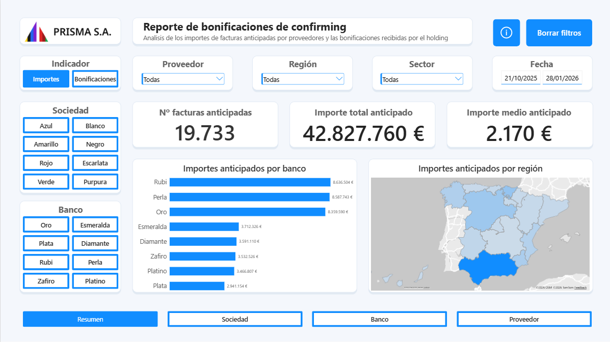
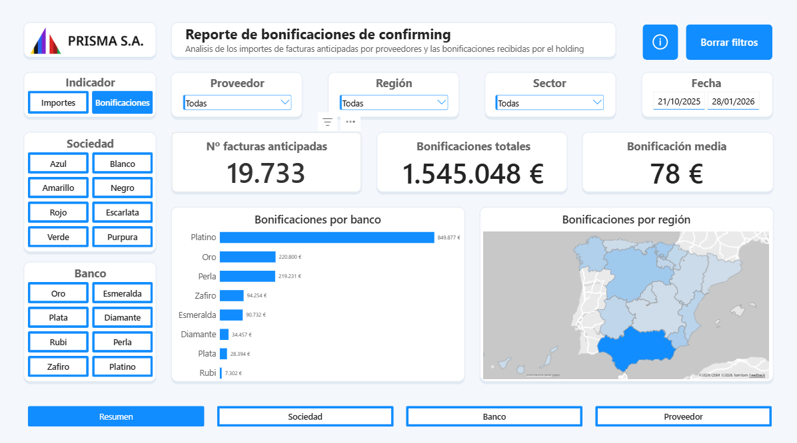
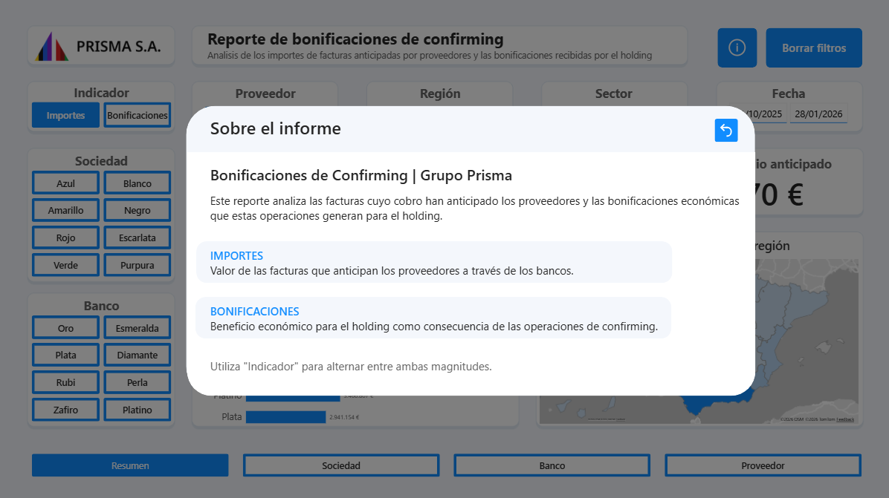
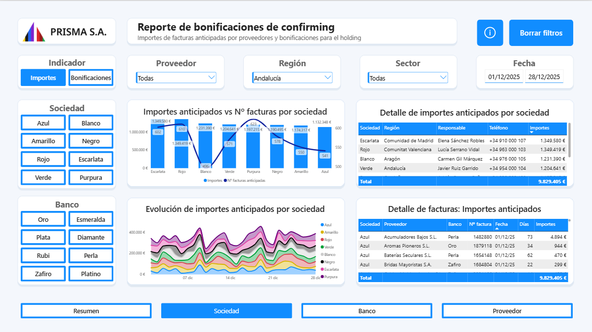
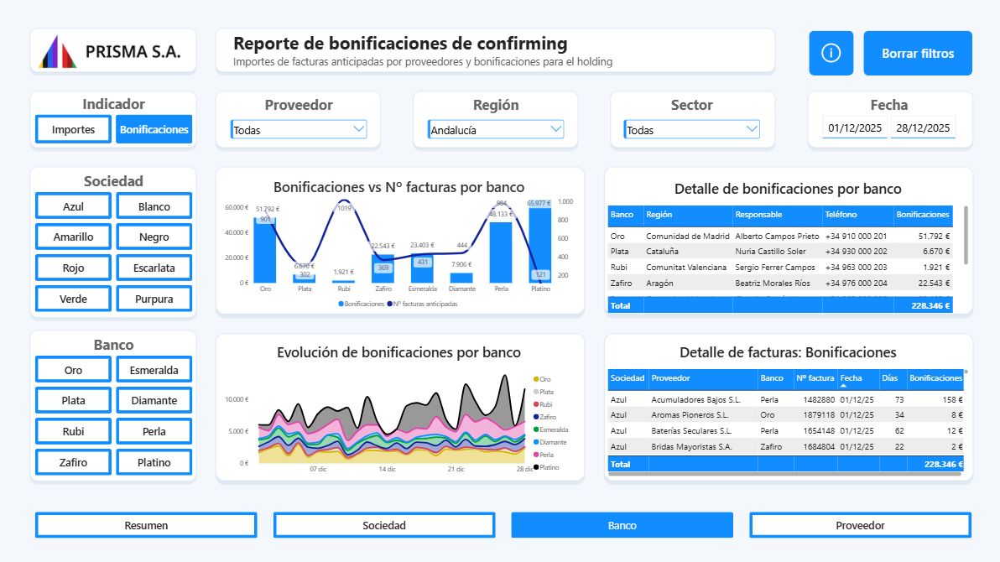
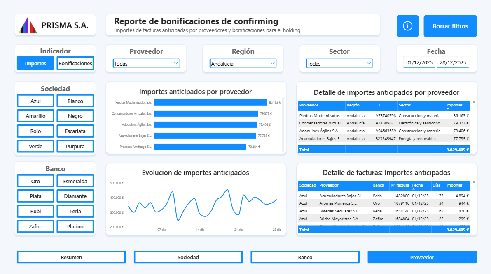
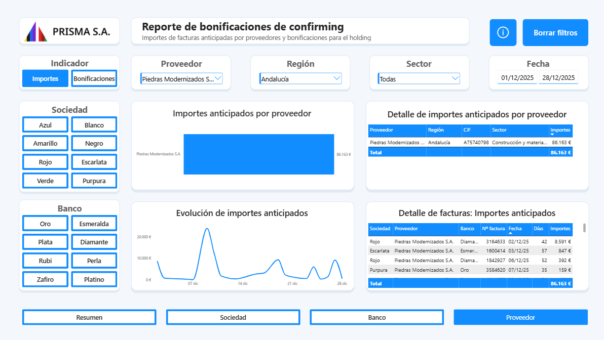

# Reporte de bonificaciones de confirming en Power BI

**Dashboard interactivo para analizar los importes de facturas anticipadas por proveedores y las bonificaciones que generan para Grupo Prisma**, un holding empresarial ficticio compuesto por ocho sociedades.

> **Datos simulados:** las empresas, los bancos, los proveedores y las operaciones representadas son ficticios.

## 1. 🔗 Contexto y origen de los datos

En el *confirming*, los proveedores pueden **anticipar el cobro de sus facturas** a través de una entidad financiera. Esta cobra por adelantar dichos **importes** y entrega una parte de los ingresos al holding en concepto de **bonificación**.

Este informe utiliza el histórico CSV generado por [**Pipeline_Auditoria_Confirming**](https://github.com/jjserranogarcia/Pipeline_Auditoria_Confirming), un proyecto en **Python** que automatiza la extracción, comprobación y seguimiento de las operaciones mediante **Google Drive** y **GitHub Actions**. El pipeline revisa los datos y **Power BI permite analizarlos visualmente**.

## 2. 📊 Funcionamiento y resumen

El informe dispone de cuatro páginas —**Resumen, Sociedad, Banco y Proveedor**— y permite alternar entre **Importes** y **Bonificaciones**, aplicar filtros y consultar tanto resultados agregados como facturas individuales.

### Importes anticipados

**Análisis de los datos**

- **Volumen:** 19.733 facturas anticipadas por **42.827.760 €**, con un importe medio de **2.170 €**.
- **Bancos:** los mayores importes corresponden a **Rubí** (8.636.504 €), **Perla** (8.587.743 €) y **Oro** (8.359.590 €).
- **Región:** **Andalucía** destaca con la mayor intensidad en el mapa, por lo que se selecciona para profundizar en las siguientes páginas.

### Bonificaciones

**Análisis de los datos**

- **Volumen:** las 19.733 facturas generan **1.545.048 €** en bonificaciones, con una media de **78 €** por factura.
- **Bancos:** lidera **Platino** (849.877 €), seguido de **Oro** (220.800 €) y **Perla** (219.231 €).
- **Comparación:** **Rubí** lidera los importes anticipados, pero **Platino** las bonificaciones; ambas magnitudes deben analizarse por separado.

El botón de información explica los conceptos del informe y ayuda a interpretar los indicadores:

## 3. 🏢 Sociedad

Esta página compara el volumen anticipado y el número de facturas por sociedad, su evolución diaria y el detalle de las operaciones.

**Análisis de los datos**

- **Selección:** Andalucía, del **01/12/2025 al 28/12/2025**, con **9.829.405 €** anticipados.
- **Importes:** **Escarlata** concentra el mayor volumen (**1.349.580 €**), seguida muy de cerca por **Rojo** (**1.349.419 €**).
- **Facturas:** **Púrpura** registra el mayor número (**623**), aunque no lidera el importe; las tablas permiten revisar el detalle.

## 4. 🏦 Banco

Esta página permite comparar las bonificaciones obtenidas por banco, el número de operaciones y su evolución durante el periodo seleccionado.

**Análisis de los datos**

- **Selección:** Andalucía, del **01/12/2025 al 28/12/2025**, con **228.346 €** en bonificaciones.
- **Bonificaciones:** destaca **Platino** (**65.977 €**), seguido de **Oro** (**51.792 €**) y **Perla** (**48.133 €**).
- **Facturas:** **Rubí** registra **1.019** operaciones, frente a las **121** de Platino: más facturas no implica necesariamente más bonificaciones.

## 5. 📦 Proveedor

Esta página identifica los proveedores con mayores importes anticipados y permite pasar de una clasificación general al detalle de un proveedor concreto.

### Clasificación de proveedores

**Análisis de los datos**

- **Selección:** Andalucía, del **01/12/2025 al 28/12/2025**, con **9.829.405 €** anticipados.
- **Proveedores:** lidera **Piedras Modernizados S.A.** (**86.163 €**), seguido de **Condensadores Virtuales S.A.** (**79.377 €**) y **Adoquines Ágiles S.A.** (**78.406 €**).
- **Siguiente análisis:** se selecciona el proveedor con mayor importe anticipado para estudiar sus operaciones individualmente.

### Análisis de un proveedor concreto

**Análisis de los datos**

- **Filtro:** se selecciona **Piedras Modernizados S.A.**, manteniendo Andalucía y el mismo periodo.
- **Importes:** el proveedor acumula **86.163 €** anticipados; el gráfico muestra cómo se distribuyen a lo largo del mes.
- **Detalle:** la tabla permite identificar las **sociedades, bancos y facturas** asociados a sus anticipos.

## 6. 💻 Tecnologías y acceso

**Power BI Desktop** para el dashboard y **CSV** como fuente de datos revisados. El tratamiento automatizado previo se documenta en [Pipeline_Auditoria_Confirming](https://github.com/jjserranogarcia/Pipeline_Auditoria_Confirming).

Para explorar el informe, descarga [`Report_Auditoria_Confirming.pbix`](Report_Auditoria_Confirming.pbix) y ábrelo en **Power BI Desktop**. Si necesitas actualizar los datos desde otro equipo, revisa la ruta del archivo de origen.
